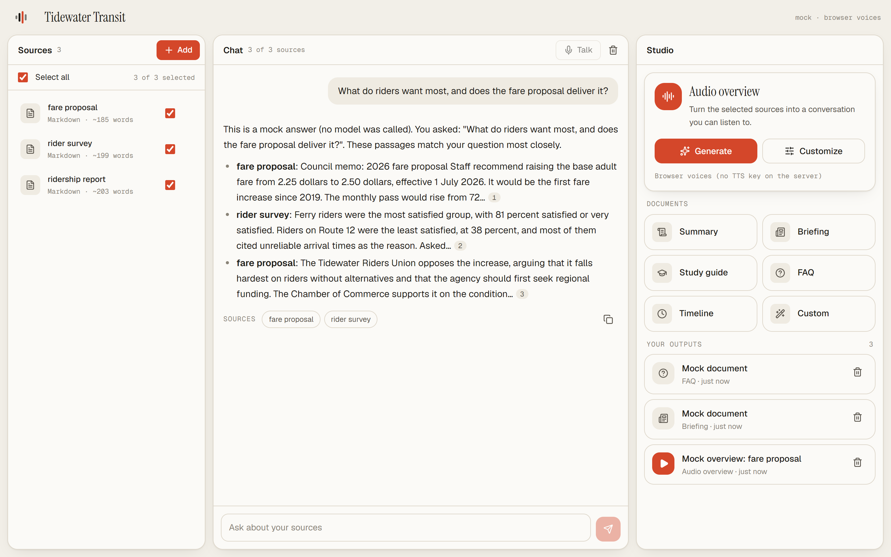
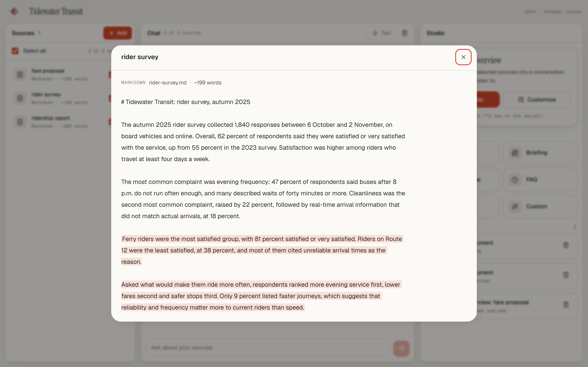
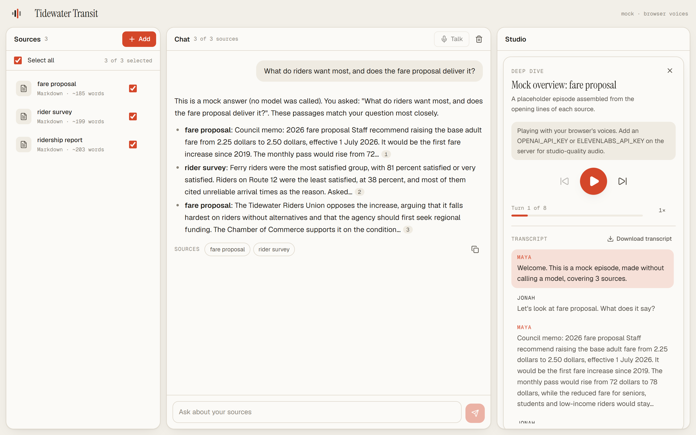
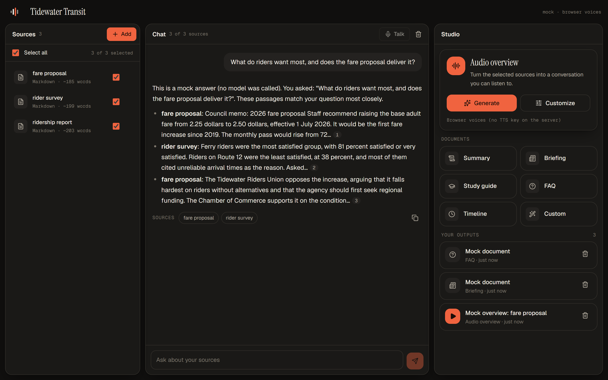

# Overtone

[](../../actions/workflows/ci.yml)


Turn a pile of sources into grounded answers, audio overviews and podcasts, and talk to them out loud.

Overtone is two things that work together or apart:

- **A headless notebook agent** (`backend/`, Python) built on [Microsoft Agent Framework](https://learn.microsoft.com/agent-framework/overview/). Use it as a Python library, a REST API or a CLI, and plug it into your own application.
- **A web app** (`src/`, Next.js) that is just one client of that API.



| Citations open the exact passage | Audio overview with transcript | Dark mode |
| --- | --- | --- |
|  |  |  |

Screenshots show the offline stand-in model, so the answer text is a placeholder. With a model key the same screens show real answers.

## What it does

- **Sources**: PDFs, Word documents, web pages, Markdown and plain text, pasted text.
- **Grounded chat**: answers come from your sources, with numbered citations that open the exact passage.
- **Audio overviews**: a two-host deep dive, brief, debate or critique, or a single-narrator overview, in three lengths, steerable with your own prompt, host names, voices and language. Rendered to MP3 when a text-to-speech key is configured; otherwise the web UI reads the script aloud with the browser's voices.
- **Documents**: summary, briefing, study guide, FAQ, timeline, or anything you describe.
- **Live voice**: talk to your notebook, or pause an episode and join the conversation. GPT-Live is the voice; the notebook agents answer from your sources.

## Try it in two minutes, no keys needed

Requirements: Python 3.11+ and Node 20+.

```bash
# 1. Backend: REST API on http://127.0.0.1:8787, running the offline stand-in model
cd backend
python -m venv .venv
source .venv/bin/activate          # Windows: .venv\Scripts\activate
pip install -e ".[dev]"
OVERTONE_MOCK=1 overtone serve     # PowerShell: $env:OVERTONE_MOCK=1; overtone serve
```

```bash
# 2. Web UI (second terminal, repository root): http://localhost:3000
npm install
npm run dev
```

```bash
# 3. Optional (third terminal, same virtualenv): load the demo notebook shown in the screenshots
python examples/rest_api.py --keep
```

The stand-in model makes no network calls. It assembles answers from the passages that best match your question, so every screen, citation and workflow works, but it does not reason. For that, add a key.

## Use real models

```bash
cp .env.example backend/.env       # then fill in the keys you have
cd backend && overtone serve
```

| Key | Unlocks |
| --- | --- |
| `ANTHROPIC_API_KEY` | Chat, scripts and documents (Claude, through Agent Framework's Anthropic client) |
| `OPENAI_API_KEY` | Rendered podcast audio **and** live voice (`gpt-live-1`) |
| `ELEVENLABS_API_KEY` | Rendered podcast audio (alternative) |

Every setting is listed in [.env.example](.env.example). Run `overtone info` to see what the engine picked up.

## Use it headless

Runnable versions of everything below are in [examples/](examples/), with sample sources.

### CLI

```bash
overtone podcast report.pdf https://example.com/post --format debate --length short --out episode.mp3
overtone doc notes.md --kind study_guide --out guide.md
overtone ask paper.pdf -q "What were the main findings?"
overtone serve --port 8787 --api-key "$OVERTONE_API_KEY" --cors https://app.example.com
overtone --help
```

Results go to stdout and progress to stderr, so commands pipe cleanly. `--json` gives machine-readable output and `--ephemeral` keeps nothing on disk.

### Python

```python
import asyncio
from overtone import create_engine, ArtifactRequest, AudioOptions, FileInput, UrlInput

async def main():
    engine = create_engine()

    # One call: sources in, finished episode out.
    result = await engine.one_shot(
        [UrlInput("https://example.com/report"), FileInput("notes.md", open("notes.md", "rb").read())],
        ArtifactRequest(kind="audio_overview", options=AudioOptions(format="deep_dive", length="medium")),
    )
    print(result.artifact.title)
    if result.audio:
        open("episode.mp3", "wb").write(result.audio[0])

    # Or drive a notebook yourself.
    notebook = await engine.notebooks.create(title="Q3 research")
    await engine.sources.add(notebook.id, UrlInput("https://example.com/q3"))
    async for event in engine.chat.stream(notebook.id, "What changed since Q2?"):
        if event["type"] == "text":
            print(event["delta"], end="")

asyncio.run(main())
```

### REST

`overtone serve` exposes everything over HTTP; chat streams as Server-Sent Events. The full reference is [docs/API.md](docs/API.md), and [examples/rest_api.py](examples/rest_api.py) walks through it. To mount Overtone inside an existing FastAPI or ASGI app:

```python
from overtone.api import create_app
app.mount("/overtone", create_app(api_key="..."))
```

### TypeScript

`packages/client` is a small typed client for the REST API (browser and Node 20+), including `LiveVoiceSession`, which runs the whole live voice flow over WebRTC.

```ts
import { createClient } from "@overtone/client";

const overtone = createClient({ baseUrl: "http://127.0.0.1:8787" });
const notebook = await overtone.notebooks.create({ title: "Research" });
for await (const event of overtone.chat.stream(notebook.id, { message: "What matters here?" })) {
  if (event.type === "text") process.stdout.write(event.delta);
}
```

## Architecture

```
┌──────────────────────┐   REST + SSE    ┌──────────────────────────────────────────────┐
│ Web UI (Next.js)     │ ──────────────▶ │ overtone (Python)                            │
│ Your app / scripts   │                 │                                              │
│ @overtone/client     │                 │  FastAPI ─▶ Engine                           │
└──────────┬───────────┘                 │              ├─ Agent Framework agents       │
           │ WebRTC (voice)              │              │    researcher · producer ·    │
           ▼                             │              │    voice-researcher           │
┌──────────────────────┐   delegation    │              ├─ Agent Framework workflow     │
│ GPT-Live (gpt-live-1)│ ◀─────────────▶ │              │    scriptwriter ─▶ sound eng. │
└──────────────────────┘   via browser   │              ├─ ingestion (PDF, DOCX, web)   │
                                         │              ├─ TTS (OpenAI / ElevenLabs)    │
                                         │              └─ storage (files, pluggable)   │
                                         └──────────────────────────────────────────────┘
```

### Built on Microsoft Agent Framework

The engine is ordinary Agent Framework code, so it composes with the rest of that ecosystem.

- **Agents** (`overtone/agents.py`): `researcher`, `producer` and `voice_researcher` are `agent_framework.Agent` instances. Import them into your own workflows.
- **Workflow** (`overtone/workflows.py`): an audio overview is a graph, `scriptwriter ─▶ sound_engineer`. Each step is an `Executor`; insert your own (a fact-check, a human review) with `WorkflowBuilder`. [examples/custom_workflow.py](examples/custom_workflow.py) does exactly that.
- **Any model**: Claude is the default, but `create_engine(chat_client=...)` accepts any Agent Framework chat client (Azure OpenAI, OpenAI, Bedrock, Ollama, and so on). Citations are provider-agnostic: sources are split into numbered passages and the model cites passage numbers, which the engine maps back to exact quotes.
- **Pluggable storage and speech**: implement the `Storage` or `TtsProvider` protocols in `overtone/models.py` to use your own database, object store or voice engine.

```python
from agent_framework import WorkflowBuilder
from overtone import create_runtime
from overtone.workflows import Scriptwriter, SoundEngineer, JobHooks

runtime, hooks = create_runtime(), JobHooks()
writer, engineer = Scriptwriter(runtime, hooks), SoundEngineer(tts=None, hooks=hooks)
workflow = WorkflowBuilder(start_executor=writer).add_edge(writer, engineer).build()
```

### Live voice

Live voice uses OpenAI's full-duplex model `gpt-live-1` as the voice and Overtone as the brain:

1. The browser creates a WebRTC offer and posts it to `POST /notebooks/{id}/live/sessions`. The server opens the GPT-Live session (the OpenAI key never reaches the browser) and returns the answer.
2. Audio flows directly between the browser and GPT-Live.
3. When the user asks about their sources, GPT-Live delegates. The browser forwards the recent transcript to `POST /notebooks/{id}/live/delegate`, the `voice_researcher` agent answers from the sources, and the browser appends the answer to the session for the voice model to say.

Two modes: **conversation** (talk to the notebook) and **podcast** (pause an episode and ask the host a question; the host knows what has been said so far, then you resume).

## Tests and evaluation

```bash
cd backend && python -m pytest          # 462 tests: engine, agents, workflows, API, CLI, evals; no network
overtone eval --mock                    # evaluation suite on the stand-in model
npm run test:client                     # 32 tests: TypeScript client and live voice session
npm run lint && npm run typecheck       # web UI
```

`overtone eval` runs 23 end-to-end cases (chat, audio, documents, guide, voice, error handling, the REST API and performance) on a small built-in corpus and writes a scorecard:

- **Structural checks** hold for any model: every quote is verbatim from its source, citation numbers match the text, scripts have the right cast and are speakable, errors carry the right code.
- **Quality checks** need a real model: the right figure is in the answer, the model declines questions the sources cannot answer, an instruction planted inside a source is not obeyed, an episode is the requested length.

```bash
overtone eval --report eval-report.md             # score the model you have configured
overtone eval --only chat,audio --json            # a subset, machine-readable
```

Method, the latest results and how to read them are in [docs/EVALUATION.md](docs/EVALUATION.md). CI runs the tests and the mock evaluation on every push.

## Project layout

```
backend/overtone/     Python package: engine, agents, workflows, ingestion, tts, live, api, cli, evals
backend/tests/        pytest suite (runs offline against the stand-in model)
packages/client/      @overtone/client: typed REST client + LiveVoiceSession
src/                  Next.js web UI
examples/             runnable examples and sample sources
docs/                 REST reference, evaluation notes, screenshots
```

## Status and limits

- Everything above is exercised offline against the stand-in model, a fake TTS provider and a fake WebRTC stack. The calls to Claude, OpenAI text-to-speech, ElevenLabs and GPT-Live are written from each provider's documentation and have **not** been run against the live services in this repository's test suite. Expect to shake out small issues the first time you add real keys, and run `overtone eval` when you do.
- A GPT-Live session has a single voice, so the join-in podcast mode brings one host into the live conversation rather than performing the whole two-host episode live.
- Scanned (image-only) PDFs are not OCR'd.
- Storage is local files by default and there is no user or auth model beyond a single API key; put it behind your own auth for multi-user use.

## Contributing

See [CONTRIBUTING.md](CONTRIBUTING.md) for setup and the checks to run, [SECURITY.md](SECURITY.md) to report a vulnerability, and [CHANGELOG.md](CHANGELOG.md) for release notes.

## License

[MIT](LICENSE)
